<!-- Profile repo: muhnazih029/muhnazih029 -->

<!-- Terminal (custom SVG, terminal style) -->
<picture><source media="(max-width: 1000px)" srcset="Assets/terminal/terminal-top-compact.svg" /></picture><a href="https://muhnazih.azdastudio.my.id"><picture><source media="(max-width: 1000px)" srcset="Assets/terminal/terminal-link-portfolio-compact.svg" /></picture></a><a href="https://www.linkedin.com/in/muhnazih029"><picture><source media="(max-width: 1000px)" srcset="Assets/terminal/terminal-link-linkedin-compact.svg" /></picture></a><a href="https://github.com/muhnazih029/Reph"><picture><source media="(max-width: 1000px)" srcset="Assets/terminal/terminal-link-reph-compact.svg" /></picture></a><a href="https://github.com/muhnazih029/SIGAP"><picture><source media="(max-width: 1000px)" srcset="Assets/terminal/terminal-link-sigap-compact.svg" /></picture></a><a href="https://github.com/muhnazih029/JobTrack"><picture><source media="(max-width: 1000px)" srcset="Assets/terminal/terminal-link-jobtrack-compact.svg" /></picture></a><picture><source media="(max-width: 1000px)" srcset="Assets/terminal/terminal-link-filler-compact.svg" /></picture>
<picture><source media="(max-width: 1000px)" srcset="Assets/terminal/terminal-fetch-compact.svg" /></picture>

<!-- Metrics -->
<<<<<<< HEAD

=======

>>>>>>> 31a6fd1 (Terminal status: only bottom-left rounded + darker bg; fastfetch bottom-right rounded; lazy-load metrics)

 

<!-- Snake (no title) -->

  

<!-- Tech stack -->

<b>Tech Stack</b>

  

<!-- Footer -->

  
  
  

