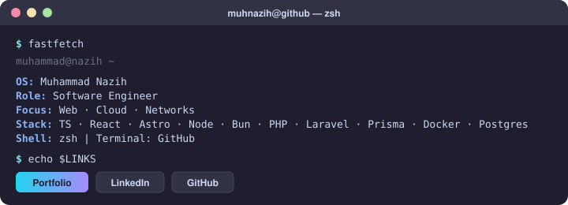

<!-- Profile repo: muhnazih029/muhnazih029 -->

<!-- Terminal (custom SVG, xCaptaiN09 style) -->

  

<!-- Status badges (xCaptaiN09 style) -->

  
  
  

---

<!-- Stats | Top langs on one line -->

  <picture>
    <source srcset="https://github-stats-extended.vercel.app/api?username=muhnazih029&show_icons=true&include_all_commits=true&hide_border=true&theme=dark_github" media="(prefers-color-scheme: dark)" />
    
  </picture>
  <picture>
    <source srcset="https://github-stats-extended.vercel.app/api/top-langs/?username=muhnazih029&layout=compact&hide_border=true&theme=dark_github" media="(prefers-color-scheme: dark)" />
    
  </picture>

<!-- Metrics (generated by lowlighter/metrics) -->

  

<!-- Streak -->

  <picture>
    <source srcset="https://streak-stats.demolab.com/?user=muhnazih029&hide_border=true&background=0D1117&border=30363D&stroke=58A6FF&ring=58A6FF&fire=1F6FEB&currStreakLabel=58A6FF&sideLabels=8B949E&currStreakNum=E6EDF3&sideNums=E6EDF3&dates=8B949E" media="(prefers-color-scheme: dark)" />
    
  </picture>

---

<!-- Tech stack (moved to bottom, above snake) -->

  

<!-- Snake (generated by snk) -->

  <picture>
    <source media="(prefers-color-scheme: dark)" srcset="https://raw.githubusercontent.com/muhnazih029/muhnazih029/output/github-contribution-grid-snake-dark.svg" />
    
  </picture>

---

Muhammad Nazih · Software Engineer · Semarang, ID

